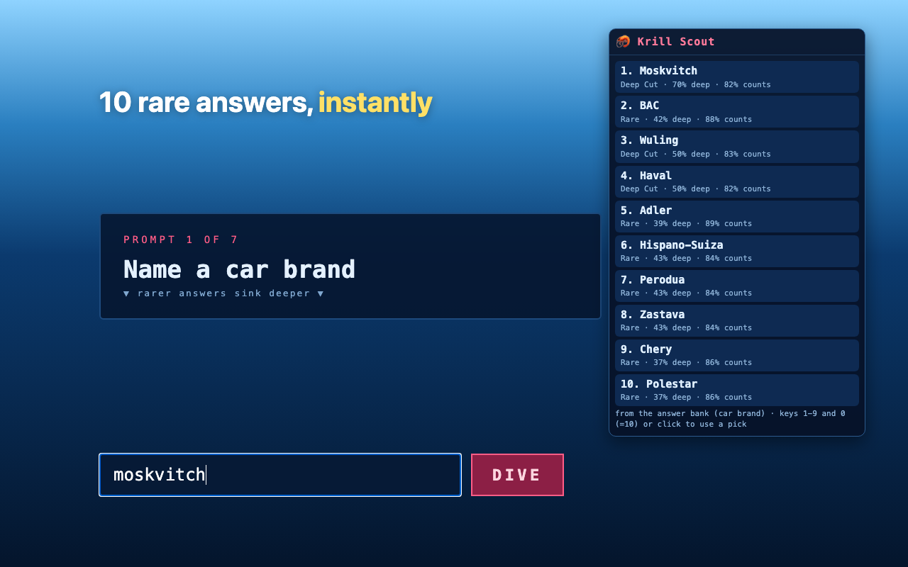

# 🦐 Krill Scout

**A free, open-source Chrome extension that suggests rare answers for [Krillion](https://krillion.io) (and the endless copy on playdaily.org), the trivia game where the rarest correct answer wins.**

For every prompt, Krill Scout shows 10 rare answers that still count and types the best one into the box. You press DIVE.

- **Instant on common topics.** A built-in bank of 9,420 rare, real answers covers 361 topics, from car brands to Beatles songs, and skips the answers the crowd always gives.
- **Letter prompts too.** "Containing ough" and "five letters starting with Q" are answered from a real dictionary in under a tenth of a second.
- **Anything else:** Chrome's free built-in AI (Gemini Nano, on your computer) adds ideas in about 2 seconds, fact-checks them, and Krill Scout ranks them by rarity.
- **Its own rarity model.** Trained on the real tiers of hundreds of past prompts. It knows the answers everyone says (Toyota, Paris, Ramen) and steers away from them.
- **Learns from your games.** Every answer you submit shows the tier you got, and Krill Scout adjusts.
- **Keys 1-9 and 0** swap in any of the 10 picks.
- **There is a cheat code.** Find it and the 🦐 menu unlocks 🔱 Deep Dive: only the picks the model rates as likely Deep Cuts. In a test on 40 dives it had never seen, picks it rated 70%+ really were Deep Cuts about 3 times as often as an average accepted answer.
- **Private.** No server, no account, no key, no tracking. See the [privacy policy](https://krill-scout-ai.netlify.app/privacy.html).

## Install

**Chrome Web Store:** coming soon.

**From this repo (2 minutes):**

1. Download this repo (green **Code** button → **Download ZIP**) and unzip it.
2. In Chrome, go to `chrome://extensions` and turn on **Developer mode** (top right).
3. Click **Load unpacked** and pick the `extension` folder.
4. Click the 🦐 icon. If it says Chrome AI needs a download, click **Set up Chrome AI** (free, one time).
5. Open krillion.io and start a dive. Picks show up in the top-right corner.

Needs Chrome 138 or newer. Chrome's built-in AI needs about 22 GB of free disk space; without it, the answer bank and letter prompts still work.

## How it works

| File | What it does |
|---|---|
| `extension/model.js` | The rarity model: word frequencies (313k words), the trained tier table, answer-bank matching, ranking |
| `extension/content.js` | Watches the game, shows the 10 picks, types the best one in |
| `extension/results.js` | Reads the tier of answers you submit, so the model learns |
| `extension/data/topics.json` | The answer bank, built from `tools/bank-src/` by `node tools/build-topics.js` |
| `extension/data/freq.txt`, `dict.txt` | English word frequencies ([wordfreq](https://github.com/rspeer/wordfreq), CC BY-SA 4.0) and dictionary headwords |

Run the tests with `npm test`. Try it without the game: serve the folder (`python3 -m http.server`) and open `test/mock-game.html`.

## Contributing

Add answers to the bank: edit a file in `tools/bank-src/` (each topic has match phrases `m` and answers `a`; answers must be real and exactly fit), run `node tools/build-topics.js`, and open a pull request.

## Fair play

Krill Scout suggests; you decide and you press DIVE. It never submits answers for you. It is a fan project, not made by or connected to Krillion.

## License

Code: MIT. Word-frequency data: CC BY-SA 4.0 (wordfreq).
